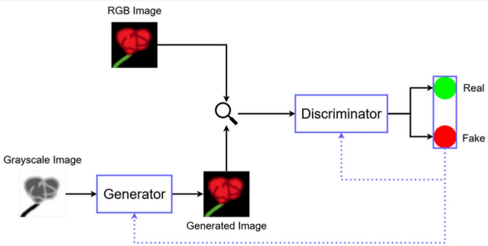

# Flower Image Colorization with a Conditional GAN

A from-scratch **pix2pix** implementation in PyTorch that colorizes hand-drawn flower line art: a U-Net generator turns a 1-channel luminance image into 3-channel colour, while a PatchGAN discriminator judges *(gray, colour)* pairs.




---

## Contents

- [Overview](#overview)
- [Quick start](#quick-start)
- [Dataset](#dataset)
- [Model architecture](#model-architecture)
- [Training](#training)
- [Evaluation](#evaluation)
- [Results](#results)
- [Design decisions](#design-decisions)
- [Repository layout](#repository-layout)
- [Limitations and next steps](#limitations-and-next-steps)
- [References](#references)

---

## Overview

The task is conditional image-to-image translation: given the grayscale version of a flower drawing, produce a plausible colour version of the same drawing. It is a small, fully self-contained benchmark — the data is synthetic, the images are 128×128, and the models are small enough to train end to end on a single GPU.

| | |
| :--- | :--- |
| **Input** | 1 × 128 × 128 luminance image, scaled to `[-1, 1]` |
| **Output** | 3 × 128 × 128 RGB image, `tanh` range `[-1, 1]` |
| **Generator** | U-Net, 3 down-sampling blocks + bottleneck + 3 up-sampling blocks with skip connections |
| **Discriminator** | PatchGAN over stacked *(gray, colour)* input, 4 channels → per-patch logits |
| **Objective** | `BCEWithLogitsLoss` (adversarial) + `100 × L1` (reconstruction) |

The repository contains the notebook that defines, trains and evaluates the model end to end; it has no dependency on any external training script.

## Quick start

### Google Colab (recommended)

1. Open `project.ipynb` in [Google Colab](https://colab.research.google.com/).
2. Select **Runtime → Change runtime type → T4 GPU**.
3. Select **Runtime → Run all**.

Section 2 (*Download the dataset*) downloads the flower archive and extracts a `flower_dataset` directory under the runtime's current directory; that folder is the relative `DATA_DIR` the notebook reads from. Each epoch writes `checkpoint.pth` inside the Colab runtime, and the final generator weights are saved to `generator.pth`. The notebook does not implement resume, so download those files before the runtime is recycled.

### Local

```bash
python -m pip install torch torchvision numpy pandas matplotlib scikit-learn scikit-image pillow gdown jupyterlab
jupyter lab project.ipynb
```

The download cell runs `gdown 1RbxAgZOqQ_NUPHCeo8ryP_ibRQpnm6Li` and then `unzip -qo flower_dataset.zip`. Colab has both tools; a local Windows machine usually has `gdown` from the install line above but no `unzip`, so either install an `unzip` or use the shortcut: download `flower_dataset.zip` and extract it into a `flower_dataset/` folder beside the notebook before running it — Section 2 skips the download when that folder already exists. PowerShell can do the extraction with `Expand-Archive flower_dataset.zip -DestinationPath .`, since the archive's top level is already `flower_dataset/`.

A CUDA device is used when available; the pipeline also runs on CPU, only slower. No runtime benchmark is recorded for this repository; the subset fraction, batch size and epoch count in the configuration cell are the knobs that control it.

## Dataset

The archive holds 128×128 RGBA PNGs of hand-drawn flowers on a transparent background. Filenames encode every axis of variation:

```
<species>_<angle>_core<stem>[_flip].png      e.g. rose_187_core4_flip.png
```

| Part | Meaning |
| :--- | :--- |
| `species` | `azalea`, `daisy`, `marigold`, `orchid`, `rose` — five flower types |
| `angle` | Rotation of the flower head, `0`–`359` degrees |
| `core1`–`core6` | One of six stem shapes drawn beneath the same flower head |
| `_flip` | Horizontal mirror of the image |

That yields **5 species × 360 angles × 6 stems × 2 flips = 21,600 valid variants** — the archive's total PNG count is higher, because it also carries the duplicate files described below.

The archive also contains `sunflower_*` and `.DS_S_*` files. These are byte-identical copies of `rose` images (a broken export, not a sixth species), so they are dropped along with `.DS_Store` during indexing.

### Subset and split

Two facts about the data drive the evaluation design:

* Adjacent angles (and their stem variants) are near-identical, so a random per-file split would leak near-copies of training images into the test set.
* A flipped image at angle *a* resembles an unflipped one at `360 − a`, so mirror twins must be grouped together.

The pipeline therefore works with the **folded angle** `min(a, 360 − a)` in 0–180°, partitions folded angles into `ANGLE_BLOCK`-degree blocks, and holds out whole blocks for testing. Training images within `SPLIT_GAP` degrees of any test angle are discarded, leaving every test image free of a near-rotation or mirror twin in training.

| Setting | Default | Role |
| :--- | :--- | :--- |
| `SUBSET_FRACTION` | `0.2` | Species-stratified sample of the 21,600 variants |
| `ANGLE_BLOCK` | `15`° | Width of the held-out unit |
| `SPLIT_GAP` | `5`° | Exclusion band around every test angle |
| `TEST_FRACTION` | `0.2` | Fraction of angle blocks held out |

## Model architecture

### Generator — U-Net

The encoder–decoder maps `1 → 32 → 64 → 128 → 256` channels while halving resolution four times — three stride-2 down-sampling blocks plus a stride-2 bottleneck — then mirrors that path back to full resolution. Each decoder level is concatenated with the matching encoder feature map, which preserves the sharp line-art edges that a plain autoencoder would blur.

| Stage | Operation | Channels | Resolution |
| :--- | :--- | :--- | :--- |
| `down1` | Conv 4×4 / 2, LeakyReLU (no norm) | 1 → 32 | 128 → 64 |
| `down2` | Conv 4×4 / 2, BatchNorm, LeakyReLU | 32 → 64 | 64 → 32 |
| `down3` | Conv 4×4 / 2, BatchNorm, LeakyReLU | 64 → 128 | 32 → 16 |
| `bottleneck` | Conv 4×4 / 2, ReLU | 128 → 256 | 16 → 8 |
| `up1` | ConvTranspose 4×4 / 2, BatchNorm, ReLU, Dropout 0.5 | 256 → 128 | 8 → 16 |
| `up2` | ConvTranspose + skip from `down3` | 256 → 64 | 16 → 32 |
| `up3` | ConvTranspose + skip from `down2` | 128 → 32 | 32 → 64 |
| `final` | ConvTranspose + skip from `down1`, `tanh` | 64 → 3 | 64 → 128 |

### Discriminator — PatchGAN

The discriminator receives the gray input and a colour image (real or generated) stacked into 4 channels and outputs a grid of **logits**, one per overlapping patch. Scoring patches rather than the whole image keeps the model focused on local colour and texture consistency and uses far fewer parameters than a full-image classifier.

| Stage | Operation | Channels | Output |
| :--- | :--- | :--- | :--- |
| 1 | Conv 4×4 / 2, LeakyReLU (no norm) | 4 → 64 | 64×64 |
| 2 | Conv 4×4 / 2, BatchNorm, LeakyReLU | 64 → 128 | 32×32 |
| 3 | Conv 4×4 / 2, BatchNorm, LeakyReLU | 128 → 256 | 16×16 |
| 4 | Conv 4×4 / 1, BatchNorm, LeakyReLU | 256 → 512 | 15×15 |
| 5 | Conv 4×4 / 1 | 512 → 1 | patch logits |

All logits are consumed by `BCEWithLogitsLoss`, so the sigmoid is applied internally — numerically more stable than an explicit `Sigmoid` + `BCELoss`. Weights follow the pix2pix initialisation: `N(0, 0.02)` for convolutions, `N(1, 0.02)` for BatchNorm scale.

## Training

Each step alternates two updates:

1. **Discriminator** — push real *(gray, real)* pairs toward 1 and generated *(gray, fake)* pairs toward 0, averaging the two BCE terms.
2. **Generator** — fool the discriminator (`g_adv`) while staying close to the real colours (`100 × L1`).

The L1 term is what keeps colour plausible: without it, the generator learns only to satisfy the discriminator and its colours drift, with `g_adv` climbing as the discriminator wins.

| Hyperparameter | Value |
| :--- | :--- |
| Image size | 128 × 128 |
| Batch size | 16 |
| Epochs | 50 |
| Optimiser | Adam, `lr = 2e-4`, `betas = (0.5, 0.999)` |
| L1 weight | 100 (pix2pix default) |
| Seed | 42 |
| Checkpointing | Every epoch → `checkpoint.pth` (runtime-local; no resume implemented) |

Losses are averaged over each epoch, not sampled from the last batch. The notebook plots `d_loss` / `g_adv` and `g_l1` separately, and the three curves only mean something read together: `g_l1` is the direct reconstruction signal, while the adversarial pair is a two-player race in which one side's improvement shows up as the other side's regression. A rising `g_adv` is therefore ambiguous — it can follow a stronger discriminator or a weaker generator — and neither adversarial loss is meaningful in isolation.

### Input preprocessing

Two details matter more than they look:

* **Transparent background → white.** The source PNGs are RGBA. A plain `convert("RGB")` composites transparency onto black, which would teach the model to paint black backgrounds. The dataset alpha-composites each image onto a white canvas first.
* **Perceptual luminance.** The gray input is `0.299R + 0.587G + 0.114B`, not a channel mean, so the input matches what a viewer reads as brightness.

Both the gray input and the colour target are scaled to `[-1, 1]` to match the generator's `tanh` output.

## Evaluation

The test set consists of the held-out angle blocks, never seen — not even as near-rotations — during training. Two per-image metrics are averaged over it, with both images in `[0, 1]`:

| Metric | Range | Reads as |
| :--- | :--- | :--- |
| **PSNR** | `0 → ∞` dB | Higher is better; fidelity of the generated colour |
| **SSIM** | `−1 → 1` | `1.0` = structurally identical to the real image |

The notebook reports both values in section 8, and displays one random test sample per species as *Input (gray) · Generated · Real* for qualitative comparison. Because the split is by angle block, the metrics measure generalization to **unseen rotations**, not to unseen flowers — a deliberately stricter test than a random file split.

## Results

The notebook's final cell renders a *Input (gray) · Generated · Real* grid for one held-out sample per species. That grid is illustrative: it shows what the output looks like and whether a given sample is plausible, not whether colours are consistent across the whole species. The aggregate evidence is in Section 8, which averages PSNR and SSIM over every held-out image rather than the five displayed samples.

No generated images or metric outputs are committed to this repository, so results are reproduced by running the notebook rather than quoted here. Section 8 prints mean PSNR and SSIM over the held-out angle blocks; those numbers depend on the sampled subset and on which blocks were held out, which is why they are computed programmatically instead of being hard-coded.

For reading the training curves: `g_l1` is the most direct reconstruction signal and should fall as the generator tracks colour and edges. Adversarial losses in a balanced GAN tend to hover near `ln 2 ≈ 0.693`, but they measure a moving equilibrium and should be read as a trend, not as an absolute score.

## Design decisions

| Decision | Rationale |
| :--- | :--- |
| Split by folded-angle block, not by file | Prevents near-duplicate leakage that would inflate PSNR/SSIM |
| Stratified `SUBSET_FRACTION` sample | Keeps all five species equally represented while fitting a free Colab GPU |
| U-Net generator | Skip connections preserve thin line-art edges lost in a plain bottleneck |
| PatchGAN discriminator | Patch-level adversarial signal improves local colour/texture realism at lower cost |
| `BCEWithLogitsLoss` | Fuses sigmoid with BCE in log-space, avoiding saturation |
| Weight init `N(0, 0.02)` | pix2pix/GAN convention that stabilises early adversarial training |

Terms such as *folded angle*, *angle block*, *variant* and *CGAN* are defined in [`CONTEXT.md`](CONTEXT.md).

## Repository layout

```
├── project.ipynb        # Setup, data pipeline, models, training loop, evaluation
├── CONTEXT.md           # Glossary: dataset vocabulary and model/eval terms
├── README.md            # This file
├── presentation.pdf     # Project presentation
└── image/
    └── CGAN.jpg         # Architecture diagram
```

The dataset is not committed; the notebook downloads `flower_dataset.zip` on first run.

## Limitations and next steps

* **Synthetic data.** The flowers are procedurally drawn and share a narrow palette per species, so these results do not transfer directly to photographs or arbitrary line art.
* **One-to-many mapping.** Colorization is inherently ambiguous — a gray outline admits many valid colourings. L1 anchors the model to the mean colour; a perceptual or adversarial-only objective would produce more varied (if less faithful) output.
* **Small generator.** Four resolution reductions (three blocks plus the bottleneck) down to 8×8 is appropriate for 128×128; higher-resolution line art would need a deeper U-Net or a patch-based inference strategy.
* **Short training budget.** The default subset and 50 epochs are tuned for a free Colab session, not for best achievable quality.

Natural follow-ups: report a PSNR/SSIM baseline (e.g. L1-only regression) next to the GAN so the adversarial term's contribution is measurable, and add a perceptual-loss variant for comparison.

## References

1. Isola, P., Zhu, J.-Y., Zhou, T., Efros, A. A. — *Image-to-Image Translation with Conditional Adversarial Networks* (pix2pix), CVPR 2017. [arXiv:1611.07004](https://arxiv.org/abs/1611.07004)
2. Ronneberger, O., Fischer, P., Brox, T. — *U-Net: Convolutional Networks for Biomedical Image Segmentation*, MICCAI 2015. [arXiv:1505.04597](https://arxiv.org/abs/1505.04597)
3. Zhu, J.-Y., Park, T., Isola, P., Efros, A. A. — *Unpaired Image-to-Image Translation using Cycle-Consistent Adversarial Networks* (CycleGAN), ICCV 2017. [arXiv:1703.10593](https://arxiv.org/abs/1703.10593)
